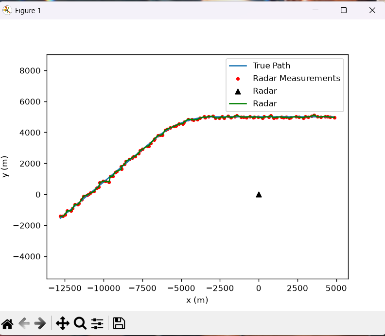
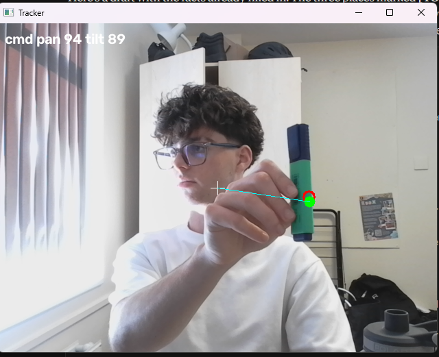

# radar-target-tracker

A Python project that tracks a moving object of certain colour from a noisy environment. It has two main versions, one where it simulates aircraft watched by a noisy radar and plots graphs to show this and the other uses live laptop webcam tracker that follows a moving coloured object and tracks it.

##Demo

## How to Run it

py -m pip install numpy matplotlib opencv-python
py tracker.py
py webcam.py

Press 'q' in video window to quit

## Next Steps

A pan tilt camera that follows the target
